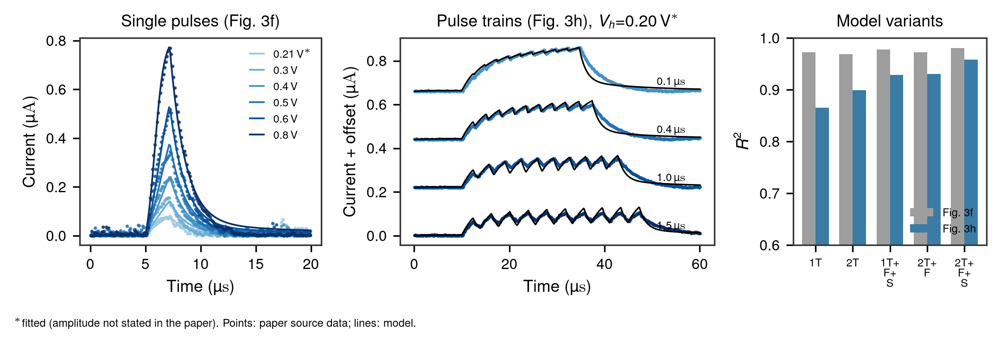
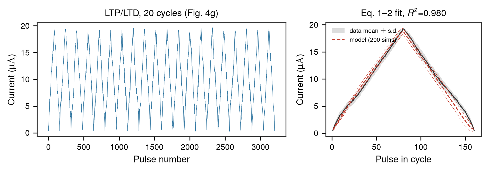

# ZnPS₃ memristor reservoir for ECG classification: a rebuild from source data

A self-study rebuild of the reservoir-computing system in a 2025 *Nature Communications* paper
on reconfigurable ZnPS₃ memristors. One device type acts as a volatile "neuron" (the reservoir),
another as a non-volatile "synapse" (the trained readout). The device models are fitted only to
the paper's published Source Data.

> **Source paper:** Ji, Y., Wang, L., Long, Y., Wang, J., Zheng, H., Yu, Z. G., Zhang, Y.-W., &
> Ang, K.-W. Ultralow energy adaptive neuromorphic computing using reconfigurable zinc phosphorus
> trisulfide memristors. *Nature Communications* 16, 6899 (2025).
> [doi:10.1038/s41467-025-62306-8](https://doi.org/10.1038/s41467-025-62306-8)

| Volatile (neuron) device model | Non-volatile (synapse) device model |
|---|---|
|  |  |

## Highlights

- Both device models fitted to the published measurements (R² ≈ 0.96–0.98).
- Hénon-map time-series prediction with the rebuilt reservoir.
- 5-class ECG classification on the MIT-BIH Arrhythmia Database at about 95 %, against 99 %
  reported in the paper.

## In this repository

`synapse_update.py` is a minimal example of the synapse update rule in the paper's Methods,
with illustrative parameters.

```bash
pip install -r requirements.txt
python synapse_update.py
```

The full rebuild code is not public. Happy to discuss the work: see
[achyar99.github.io](https://achyar99.github.io).

Achyarul Mabruri · MIT licence for the code in this repository.
